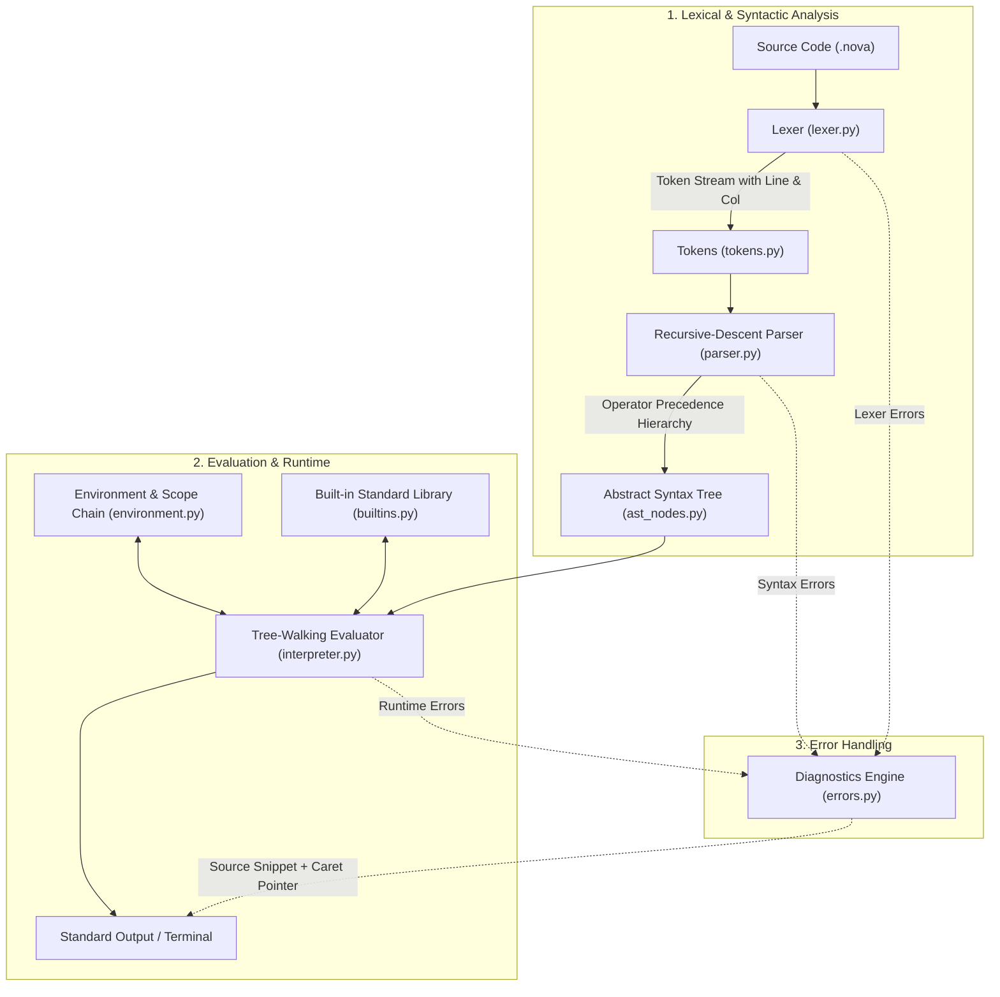
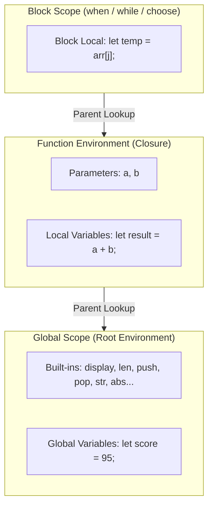

# 🌌 Nova Programming Language

<p align="center">
  <strong>A modern, custom, dynamically-typed programming language built from scratch in Python.</strong>
</p>

<p align="center">
  
  
  
  
  
  
</p>

---

## 🌟 An Open-Source Project for Everyone

**Nova** is an open-source programming language created for developers, students, researchers, and hobbyists who want to understand how programming languages actually work under the hood. 

Unlike toy tutorials or simple syntax wrappers, Nova is a **genuine tree-walking interpreted programming language**:
- 🚫 **No Transpilation**: Nova source code is never translated into Python.
- 🚫 **No `eval()` or `exec()`**: Every statement and expression is parsed and evaluated by our own interpreter engine.
- 🚫 **No Third-Party Frameworks**: The core lexer, parser, Abstract Syntax Tree (AST), environment, and evaluator are built 100% from scratch.
- 🤝 **Open for All**: Designed to be beginner-friendly to explore, hack, fork, and contribute to!

---

## 🏗️ Interpreter Architecture & Flowcharts

Nova processes source code through a clean, decoupled interpreter pipeline:

### 1. Complete Execution Pipeline



### 2. Lexical Scoping and Environment Resolution



---

## 📖 Language Syntax & Custom Keywords

Nova features an expressive, distinctive syntax designed for clarity:

| Concept | Nova Keyword / Syntax | Example | Description |
|---|---|---|---|
| **Variable** | `let` | `let x = 10;` | Declares variable in current scope |
| **Output** | `display()` | `display("Hello!");` | Prints value followed by newline |
| **Functions** | `Event` | `Event add(a, b) { return a + b; }` | Declares first-class function |
| **Return** | `return` | `return 42;` | Returns from an `Event` function |
| **If** | `when` | `when (score >= 90) { ... }` | Conditional branch |
| **Else If** | `otherwise when` | `otherwise when (score >= 75) { ... }` | Chained condition |
| **Else** | `otherwise` | `otherwise { ... }` | Fallback condition |
| **Switch** | `choose` | `choose (val) { option 1 { ... } fallback { ... } }` | Selection block (no fallthrough) |
| **Case** | `option` | `option 1 { display("One"); }` | Selection branch |
| **Default** | `fallback` | `fallback { display("Other"); }` | Default selection branch |
| **While Loop** | `while` | `while (i < 5) { i = i + 1; }` | Loops while condition is `true` |
| **Booleans** | `true` / `false` | `let active = true;` | Boolean literals |
| **Null** | `null` | `let result = null;` | Null literal |
| **Logical** | `and`, `or`, `not` | `when (x > 0 and not ready) { ... }` | Short-circuiting logical operators |
| **Comments** | `//` | `// Single-line comment` | Ignored by lexer |

---

## 🚀 Quick Start Guide

### 1. Prerequisites
Nova requires **Python 3.11** or newer. Check your installed Python:
```bash
python --version
# or on Windows:
py --version
```

### 2. Clone the Repository
```bash
git clone https://github.com/your-username/nova-language.git
cd nova-language
```

### 3. Run Your First Nova Program
Run any `.nova` file directly:
```bash
py main.py examples/hello.nova
```

Output:
```text
Hello, World!
```

---

## 💻 Code Examples

### 1. Variables & Exact Math
```nova
// examples/variables.nova
let a = 12;
let b = 4;

display(a + b);  // 16
display(a * b);  // 48
display(a / b);  // 3 (exact integer division produces integer)
display(7 / 2);  // 3.5 (non-exact division produces float)
```

### 2. Conditionals (`when` / `otherwise when` / `otherwise`)
```nova
// examples/conditionals.nova
let marks = 85;

when (marks >= 90) {
    display("Grade A");
} otherwise when (marks >= 75) {
    display("Grade B");
} otherwise {
    display("Grade C");
}
```

### 3. Switch Selection (`choose` / `option` / `fallback`)
```nova
// examples/choose.nova
let day = 2;

choose (day) {
    option 1 {
        display("Monday");
    }
    option 2 {
        display("Tuesday");
    }
    fallback {
        display("Other day");
    }
}
```

### 4. Functions & Closures (`Event`)
```nova
// examples/functions.nova
Event make_multiplier(factor) {
    Event multiplier(x) {
        return x * factor;
    }
    return multiplier;
}

let double = make_multiplier(2);
let triple = make_multiplier(3);

display(double(5)); // 10
display(triple(5)); // 15
```

### 5. Lists & Array Operations
```nova
// examples/lists.nova
let numbers = [10, 20, 30];

// Indexing and assignment
display(numbers[0]); // 10
numbers[1] = 99;
display(numbers);    // [10, 99, 30]

// Built-in collection methods
push(numbers, 40);
display(numbers);    // [10, 99, 30, 40]

let last = pop(numbers);
display(last);       // 40

// Concatenation
let combined = [1, 2] + [3, 4];
display(combined);   // [1, 2, 3, 4]
```

### 6. Classic Algorithms (Bubble Sort & Binary Search)
```nova
// examples/sorting.nova
Event bubble_sort(arr) {
    let n = len(arr);
    let i = 0;
    while (i < n) {
        let j = 0;
        while (j < n - i - 1) {
            when (arr[j] > arr[j + 1]) {
                let temp = arr[j];
                arr[j] = arr[j + 1];
                arr[j + 1] = temp;
            }
            j = j + 1;
        }
        i = i + 1;
    }
    return arr;
}

let items = [64, 34, 25, 12, 22, 11, 90];
display(bubble_sort(items)); // [11, 12, 22, 25, 34, 64, 90]
```

---

## 🖥️ Interactive REPL Shell

Launch the interactive REPL by running `main.py` without arguments:
```bash
py main.py
```

```text
Nova Language v0.1.0
Type :help for commands and :quit to exit.

nova> let greeting = "Hello, Open Source!";
nova> display(greeting);
Hello, Open Source!
nova> Event add(a, b) { return a + b; }
nova> display(add(20, 22));
42
nova> :quit
```

### REPL Commands:
- `:help` — Shows language syntax, keywords, and command summary.
- `:load <filepath>` — Loads and executes any `.nova` file into the current active session.
- `:clear` — Clears the terminal screen.
- `:quit` — Exits the shell cleanly.

---

## 🛠️ CLI Flags & Compiler Inspection

| Flag | Description | Example |
|---|---|---|
| `<file>` | Executes a `.nova` source file | `py main.py my_program.nova` |
| `--tokens` | Dumps the lexer token stream | `py main.py --tokens examples/hello.nova` |
| `--ast` | Renders the parsed Abstract Syntax Tree | `py main.py --ast examples/hello.nova` |
| `--version` | Displays the current Nova version | `py main.py --version` |
| `--max-steps <N>` | Configures loop safeguard limit | `py main.py --max-steps 500000 app.nova` |
| `--max-call-depth <N>`| Configures recursion limit | `py main.py --max-call-depth 1000 app.nova` |

---

## 🧪 Automated Testing

Nova comes with a comprehensive test suite of **94 automated tests** covering every component:

```bash
# Install pytest
py -m pip install -r requirements-dev.txt

# Run all tests
py -m pytest -v
```

```text
============================= test session starts =============================
platform win32 -- Python 3.14.3, pytest-9.1.1, pluggy-1.6.0
rootdir: NOVA-New Programming Language
collected 94 items

tests/test_builtins.py .......                                           [  7%]
tests/test_cli.py ........                                               [ 15%]
tests/test_environment.py .........                                      [ 25%]
tests/test_errors.py ...                                                 [ 28%]
tests/test_functions.py ..........                                       [ 39%]
tests/test_interpreter.py ................                               [ 56%]
tests/test_lexer.py ..............                                       [ 71%]
tests/test_lists.py .............                                        [ 85%]
tests/test_parser.py ..............                                      [100%]

============================= 94 passed in 0.17s ==============================
```

---

## ⚡ Performance Benchmarks

Run the built-in benchmark script to measure raw interpreter speed:
```bash
py benchmark.py
```

```text
Nova Interpreter Benchmark Suite
----------------------------------
=== Recursive Fibonacci(18) ===
  Lexing:       0.13 ms
  Parsing:      0.17 ms
  Execution:   72.09 ms
  Total:       72.40 ms

=== While Loop (5,000 iterations) ===
  Lexing:       0.09 ms
  Parsing:      0.15 ms
  Execution:   19.14 ms
  Total:       19.37 ms
```

---

## 🤝 Contributing to Nova (Open Source for All)

Contributions of all kinds are warmly welcomed! Whether you are fixing a typo, adding a new standard library function, writing new example algorithms, or exploring a Bytecode Virtual Machine, here is how you can help:

### How to Contribute
1. **Fork the Repository** on GitHub.
2. **Create a Feature Branch**:
   ```bash
   git checkout -b feature/my-new-feature
   ```
3. **Write Your Changes & Add Tests**:
   - Add unit tests under `tests/`.
   - Ensure all 94+ tests pass: `py -m pytest`.
4. **Commit & Push**:
   ```bash
   git commit -m "Add feature: my new feature"
   git push origin feature/my-new-feature
   ```
5. **Open a Pull Request** describing your changes.

### Great First Contributions
- 🧩 Add new mathematical or string functions to `src/nova/builtins.py`.
- 📚 Write new classic algorithms in Nova under `examples/` (e.g. merge sort, graph traversal).
- 🎨 Syntax highlighting extensions for VS Code or Sublime Text.
- 🚀 Implement the Bytecode Virtual Machine specified in [`docs/vm_design.md`](docs/vm_design.md).

---

## 📄 License

Nova is proudly licensed under the [MIT License](LICENSE). You are free to use, modify, distribute, and build commercial or educational projects with Nova.

---

<p align="center">
  Crafted with ❤️ for programming language enthusiasts and students worldwide.
</p>
