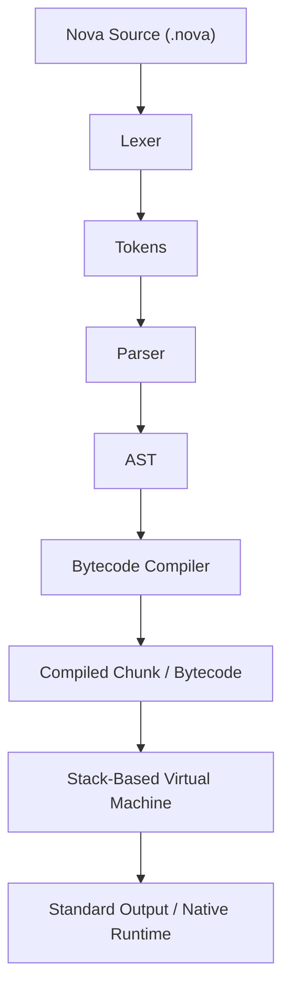

# Nova Bytecode Virtual Machine & Compiler Architecture Design

## 1. Executive Summary

The current Nova implementation is a **tree-walking interpreter** that evaluates Abstract Syntax Tree (AST) nodes directly. While clear, robust, and extensible, tree-walking incurs execution overhead due to deep Python recursion, object traversal, and dynamic node dispatch.

This document outlines the design for a future **bytecode compiler and stack-based virtual machine (VM)** for Nova. Moving to a bytecode VM provides:
- **Linear instruction streams** with high CPU cache locality.
- **Fixed-size bytecode instructions** eliminating tree pointer-chasing.
- **Flat call frames** replacing recursive Python evaluator frames.
- **10x to 50x execution speedups** for recursive algorithms and loops.

---

## 2. Compilation Pipeline



1. **Front-End (Unchanged)**: The existing Lexer, Parser, and AST are reused without modification.
2. **Compiler Pass**: Traverses the AST once, emitting linear bytecode instructions, resolving local variable stack offsets, and assembling jump labels.
3. **Bytecode Chunk**: Contains instruction opcodes, operand bytes, line-number debug maps, and a constant pool.
4. **Virtual Machine (VM)**: A stack-based execution loop dispatching bytecodes using integer operations.

---

## 3. Instruction Set Architecture (ISA)

Nova's bytecode instruction set uses 8-bit opcodes followed by optional 8-bit or 16-bit operands.

### 3.1. Literals and Constants
| Opcode | Operands | Stack Effect | Description |
|---|---|---|---|
| `OP_CONSTANT` | `u16 const_idx` | `-> [val]` | Pushes constant from constant pool. |
| `OP_NULL` | None | `-> [null]` | Pushes `null`. |
| `OP_TRUE` | None | `-> [true]` | Pushes boolean `true`. |
| `OP_FALSE` | None | `-> [false]` | Pushes boolean `false`. |

### 3.2. Arithmetic and Comparisons
| Opcode | Operands | Stack Effect | Description |
|---|---|---|---|
| `OP_ADD` | None | `[a, b] -> [a + b]` | Adds numbers, concatenates strings or lists. |
| `OP_SUB` | None | `[a, b] -> [a - b]` | Subtracts numbers. |
| `OP_MUL` | None | `[a, b] -> [a * b]` | Multiplies numbers. |
| `OP_DIV` | None | `[a, b] -> [a / b]` | Divides numbers. |
| `OP_MOD` | None | `[a, b] -> [a % b]` | Computes integer/float modulo. |
| `OP_NEGATE` | None | `[a] -> [-a]` | Negates numeric value. |
| `OP_NOT` | None | `[a] -> [!a]` | Logical boolean inversion. |
| `OP_EQUAL` | None | `[a, b] -> [bool]` | Tests deep equality. |
| `OP_GREATER` | None | `[a, b] -> [bool]` | Tests `a > b`. |
| `OP_LESS` | None | `[a, b] -> [bool]` | Tests `a < b`. |

### 3.3. Variable Storage and Scoping
| Opcode | Operands | Stack Effect | Description |
|---|---|---|---|
| `OP_GET_LOCAL` | `u8 slot` | `-> [val]` | Reads local from the current frame's stack slot. |
| `OP_SET_LOCAL` | `u8 slot` | `[val] -> [val]` | Writes local to stack slot. |
| `OP_GET_GLOBAL` | `u16 name_idx` | `-> [val]` | Looks up global variable in global table. |
| `OP_SET_GLOBAL` | `u16 name_idx` | `[val] -> [val]` | Reassigns existing global variable. |
| `OP_DEFINE_GLOBAL` | `u16 name_idx` | `[val] -> []` | Declares and binds global variable. |

### 3.4. Control Flow and Jumps
| Opcode | Operands | Stack Effect | Description |
|---|---|---|---|
| `OP_JUMP` | `u16 offset` | None | Unconditional forward jump. |
| `OP_JUMP_IF_FALSE` | `u16 offset` | `[cond] -> [cond]` | Jumps forward if top of stack is `false`. |
| `OP_LOOP` | `u16 offset` | None | Backward jump to loop header. |
| `OP_POP` | None | `[val] -> []` | Discards top stack value. |

### 3.5. Collections (Lists)
| Opcode | Operands | Stack Effect | Description |
|---|---|---|---|
| `OP_BUILD_LIST` | `u16 count` | `[v0..vN] -> [list]` | Creates list with `count` elements. |
| `OP_INDEX_GET` | None | `[target, idx] -> [val]` | Reads element at index. |
| `OP_INDEX_SET` | None | `[target, idx, val] -> [val]` | Modifies element at index in place. |

### 3.6. Functions and Closures
| Opcode | Operands | Stack Effect | Description |
|---|---|---|---|
| `OP_CALL` | `u8 arg_count` | `[callee, a0..aN] -> [ret]` | Invokes function with argument count. |
| `OP_CLOSURE` | `u16 fn_idx` + upvalues | `-> [closure]` | Instantiates closure capturing upvalues. |
| `OP_GET_UPVALUE` | `u8 upval_idx` | `-> [val]` | Accesses closed-over outer variable. |
| `OP_SET_UPVALUE` | `u8 upval_idx` | `[val] -> [val]` | Writes closed-over outer variable. |
| `OP_CLOSE_UPVALUE` | None | `[val] -> []` | Moves local from stack to heap on scope exit. |
| `OP_RETURN` | None | `[ret] -> []` | Unwinds frame and returns value to caller. |

---

## 4. Virtual Machine Runtime Structure

```text
+-----------------------------------------------------------+
|                      Nova Virtual Machine                 |
|                                                           |
|  +--------------------+       +------------------------+  |
|  |     Value Stack    |       |       Call Frames      |  |
|  | [10, "Nova", true] |       |  [Frame 0: main]       |  |
|  |                    |       |  [Frame 1: fib(18)]    |  |
|  +--------------------+       +------------------------+  |
|                                                           |
|  +--------------------+       +------------------------+  |
|  |   Globals Table    |       |   Open Upvalues List   |  |
|  | {"score": 42, ...} |       |  [Upval -> Slot 3]     |  |
|  +--------------------+       +------------------------+  |
+-----------------------------------------------------------+
```

### 4.1. CallFrame Representation
Each function invocation pushes a `CallFrame`:
```python
class CallFrame:
    closure: ObjClosure
    ip: int          # Instruction pointer into chunk bytecode
    slots: int       # Base index on the VM value stack for local variables
```

### 4.2. Upvalue Handling for Closures
When an inner `Event` function captures a variable declared in an enclosing scope:
1. While the enclosing function is executing, the upvalue points directly to the variable's stack slot (**open upvalue**).
2. When the enclosing function exits, `OP_CLOSE_UPVALUE` copies the value into the upvalue object on the heap (**closed upvalue**).
3. The closure retains access regardless of lifetime.

---

## 5. Execution Loop Implementation Outline

```python
def run(self) -> None:
    frame = self.frames[-1]
    
    while True:
        instruction = frame.closure.function.chunk.code[frame.ip]
        frame.ip += 1
        
        if instruction == OP_CONSTANT:
            constant = frame.closure.function.chunk.constants[self.read_u16(frame)]
            self.push(constant)
            
        elif instruction == OP_ADD:
            b = self.pop()
            a = self.pop()
            self.push(self.add_values(a, b))
            
        elif instruction == OP_JUMP_IF_FALSE:
            offset = self.read_u16(frame)
            if self.peek() is False:
                frame.ip += offset
                
        elif instruction == OP_CALL:
            arg_count = self.read_u8(frame)
            self.call_value(self.peek(arg_count), arg_count)
            frame = self.frames[-1]
            
        elif instruction == OP_RETURN:
            result = self.pop()
            self.close_upvalues(frame.slots)
            self.frames.pop()
            if not self.frames:
                return result
            self.stack_top = frame.slots
            self.push(result)
            frame = self.frames[-1]
```

---

## 6. Migration Plan

1. **Milestone 1**: Keep AST front-end intact; add `compiler.py` that emits flat chunks for arithmetic and expressions.
2. **Milestone 2**: Implement core `vm.py` with binary operators, jumps, loops, and conditions.
3. **Milestone 3**: Implement CallFrames, functions (`Event`), recursion, and built-in dispatch.
4. **Milestone 4**: Implement upvalues and closures.
5. **Milestone 5**: Provide dual mode CLI flags (`--vm` vs `--tree-walk`) for side-by-side benchmarking.
